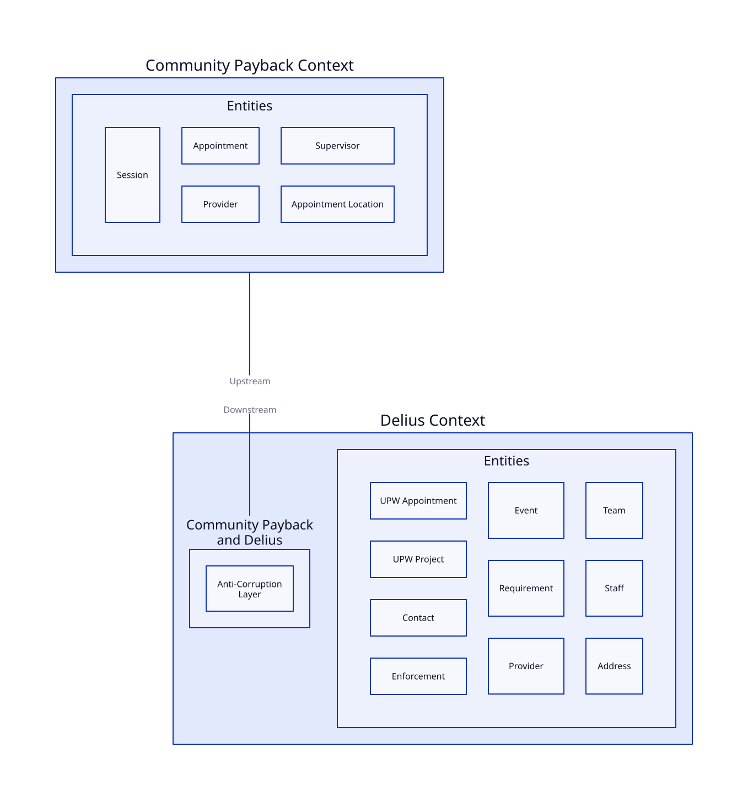

# Community Payback and Delius

Integration service enabling the [Community Payback service](https://github.com/ministryofjustice/hmpps-community-payback-api) to retrieve and update details about Unpaid Work appointments and projects from NDelius.

## Business Need

The Community Payback service requires access to up-to-date information about Unpaid Work appointments and projects for people on probation. This integration service provides APIs to:

- Retrieve Unpaid Work appointment, session and project details from NDelius
- Create, update, and delete Unpaid Work appointments and project records in NDelius
- Upload documents (such as certificates or evidence) to Alfresco and link them to appointments in NDelius

## Interfaces

### API Endpoints

The service exposes RESTful API endpoints for the Community Payback service to:

- Search for and retrieve Unpaid Work appointments and project details
- Create, update, or delete Unpaid Work appointments and projects
- Upload, list, download or delete documents related to Unpaid Work appointments
- Retrieve personal circumstances for a person by CRN

API endpoints are secured and require appropriate roles via HMPPS Auth.

### Message/Event Handling

(If the service consumes or produces domain events, describe them here. Otherwise, remove this section.)

## Context Map

## Authorisation

API endpoints are protected by roles supplied by the HMPPS Auth client. Only authorised clients can access or modify Unpaid Work data.

| API Endpoint       | Required Role                        |
|--------------------|--------------------------------------|
| /projects/**       | ROLE_COMMUNITY_PAYBACK_UNPAID_WORK   |
| /providers/**      | ROLE_COMMUNITY_PAYBACK_UNPAID_WORK   |
| /supervisors/**    | ROLE_COMMUNITY_PAYBACK_UNPAID_WORK   |
| /reference-data/** | ROLE_COMMUNITY_PAYBACK_UNPAID_WORK   |
| /appointments/**   | ROLE_COMMUNITY_PAYBACK_UNPAID_WORK   |
