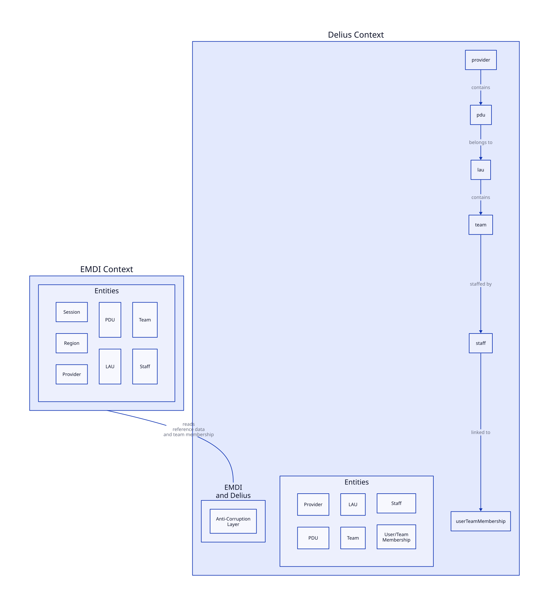

# EMDI and Delius

This service enables the [EMDI](https://github.com/ministryofjustice/hmpps-electronic-monitoring-service) service to retrieve reference data and user/team structure from NDelius so it can present the correct organisational context for users and support case workflows.

## Business need

EMDI requires access to probation organisational reference data from Delius to support operational user journeys and ensure the correct teams, regions and PDUs are available to users.

This integration service provides read-only APIs for:

- retrieving regions and PDUs from Delius
- retrieving the teams associated with a user
- exposing the organisational structure required by EMDI to support user routing and service configuration

This reduces the need for EMDI to maintain duplicate reference data and keeps the service aligned with the source of truth in Delius.

## Interfaces

### API endpoints

The service exposes RESTful APIs for EMDI to retrieve the reference data it needs:

- `GET /regions`
    - Returns the list of regions configured in Delius
- `GET /regions/{regionCode}/pdu`
    - Returns the PDUs for a given region
- `GET /user/{username}/teams`
    - Returns the teams associated with a given user

These endpoints are secured and require the appropriate HMPPS Auth role.

### Message / event handling

This service does not currently consume or publish domain events. It is a reference-data integration service for read-only lookups from Delius.

## Context map

## Authorisation

API endpoints are protected by roles supplied by the HMPPS Auth client used in the requests.

| API Endpoint         | Required Role                                     |
|----------------------|---------------------------------------------------|
| `/regions/**`        | `ROLE_PROBATION_API__EMDI__REFERENCE_DATA`        |
| `/user/**`           | `ROLE_PROBATION_API__EMDI__REFERENCE_DATA`        |

## How it works

The service sits between EMDI and Delius and exposes a small, controlled set of lookup APIs. It reads data from Delius and returns it as simplified coded values and team data that EMDI can consume without needing direct access to the full Delius domain model.

This keeps the integration focused on:
- organisational hierarchy lookup
- user-to-team mapping
- reliable access to reference data needed by the EMDI application

## Why this matters

Having this data available through a dedicated service allows EMDI to:
- present accurate regional and team information
- route users to the correct organisational context
- reduce duplication and maintenance of reference data in upstream systems
- keep Delius as the system of record for organisational structure and team membership